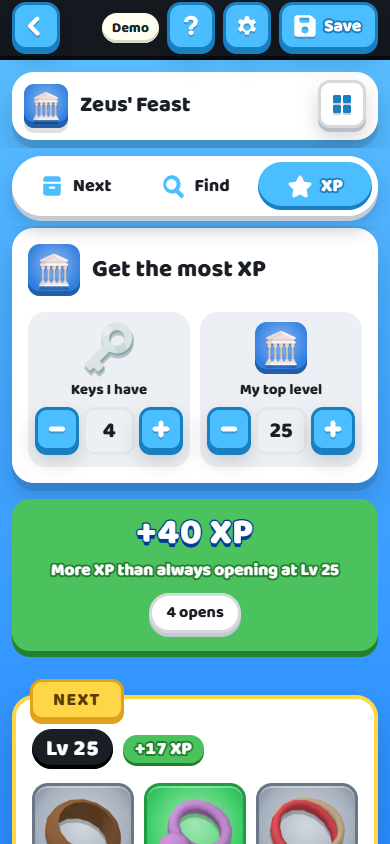
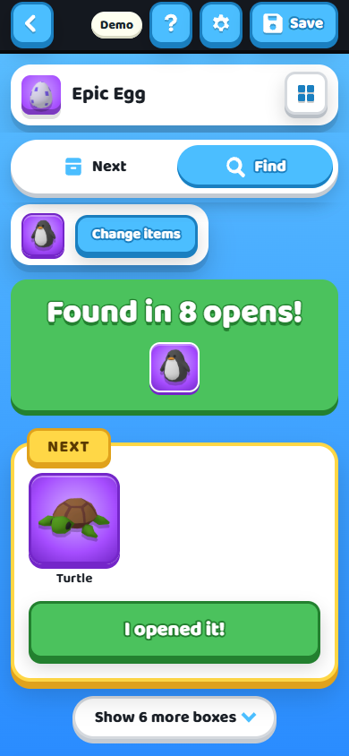

# Loot Lookout

An Eatventure loot predictor: see what is coming in your next box, find an
item you want, and plan adventure replays. Item pictures, readable names, and
rarity labels make the drops easy to recognize.

1. Tap **Load my save**, or **Try demo** to explore with sample data.
2. **Pick a box** (or an egg under **Pets**) to see its next drops, in order.
3. Open it in Eatventure, then tap **I opened it!** here to keep your tracker
   in step with the game. Tapped by mistake? The toast has an **Undo**.


Marking an opening only updates this browser's tracker. It does not open
anything in Eatventure or change your save file. Savegames are parsed entirely
in the browser; nothing is uploaded or written back to the save.

## How it works

- **PRNG**: the engine does not use an LCG. It uses C#'s `System.Random`
  (Knuth subtractive / lagged Fibonacci), which Mono ships and which the
  persisted per-chest `Seed` is fed into. Ported draw for draw in
  `src/rng/unity-random.js`.
- **Draw order**: per item, draw 1 picks the prize type from a weighted table,
  draw 2 picks the item inside that rarity pool. After the last item, one final
  draw produces the seed persisted for the *next* open. That trailing draw is
  why chests chain.
- **Loot tables**: mapped empirically from logged openings (`src/loot/tables.js`).
- **Savegame**: the file is prefixed with a base64 integrity hash before the
  JSON body, so the parser slices from the first `{` to the last `}`.

## Run

Use Node.js 24 LTS. The tooling also supports Node.js 22 (22.12 or later)
and Node.js 26 or later.

    npm ci
    npm run dev

## Tests

    npm test
    npm run test:watch
    npm run test:coverage

The suite checks C# PRNG reference draws, loot tables and seed chaining,
savegame parsing, session persistence, both solvers, DOM rendering, app flows,
and the CLI. Save fixtures are synthetic; no real savegame files are needed.

Coverage includes every JavaScript file under `src/` and the CLI under `tools/`.
Each file must reach **100% statements, branches, functions, and lines**.
`npm run test:coverage` writes an HTML report to `coverage/index.html` and JSON
reports alongside it. CI runs the same coverage check before building.

## Web UI

### Next drops

The demo uses a synthetic save, so you can explore without a real save file.
Load your own save to see predictions for your boxes and eggs. Each card shows
the real game art on rarity-coloured tiles; the next box wears a gold **NEXT**
ribbon, later ones a number. Adventure cards show the level as **Lv 25**. The
layout adapts to phones, and controls have keyboard focus states and labels.

After opening a box in Eatventure, tap **I opened it!**, or **I opened up to #N**
on a later card to mark several at once. Settings (the gear) can mark 5, 10 or
any number. Your current position and the most recent 100 openings survive a
refresh and show under **Opened**. The **Save** menu can **Reset this box**
(back to its position in the loaded save, clearing its history) or **Remove
from this device** (clears the saved tracker data).

The browser stores extracted box data, tracked openings, selected items,
preferences, and the file name.

Settings also hold the key drop chance (adventures only) and, under
**Advanced**, the raw seed and seed details. Loading another save or changing a
route's seed or options clears stale routes.

### Plan your best XP path



Adventure chests let you choose a level per open, and the level you pick for
open #1 changes every draw after it. So the best route is a search, not a
per-open choice: a weak first open at a low level can set up a much better
second one. Vault keys refund an opening, so a path can run deeper than the
free-openings budget suggests.

On an adventure box, the **XP** tab takes the keys you have and your top level,
then plans every opening: each step shows the level to pick (**Lv 24**) and
the XP it earns, and the banner compares the plan with always opening at your
top level.

### Find an item



Tap the pictures of the items you want (search and rarity chips narrow the
list), then tap **Find it!** to search for a route that collects **all selected items**,
starting from your current tracked position. Adventure chests get a full search
over levels; everything else has no level to choose, so it walks the chain
until the items turn up.

Interactive Find searches remain cancellable and stop after 100,000 simulated
openings. A stopped or limited run explicitly marks its results as incomplete;
its routes are the best found so far. Library callers can set `maxNodes` on the
async search APIs, while the synchronous APIs retain an unlimited node budget
unless one is supplied. Targets match item IDs across all listed rarities.

## CLI

    node tools/predict.mjs <savegame.json> [cardId] [count]

With no `cardId`, it lists every chest and egg in the save:

    $ node tools/predict.mjs savegame.json
    chests found in save:

      small                seed=  102938475  opened=37
      big                  seed=    1839201  opened=12
      adventure_Zeus       seed=  774451920  opened=88  level=42
      adventure_Pirate     seed=   49281773  opened=5  level=17
      egg_Epic             seed=  662310945

With a `cardId`, it walks the chain:

    $ node tools/predict.mjs savegame.json big 3
    big  seed=1839201  next 3 opens

    open #1  (seed 1839201)
        Equipment: Body_Apron_Purple (Epic)
        Equipment: Hat_Cashier (Common)
        Equipment: Hat_Cashier_Blue (Common)
        Equipment: Tool_SoupSpoon (Common)
        Equipment: Body_Apron_Purple (Epic)
        Equipment: Hat_Chef_Black (Epic)
        -> nextSeed 660464753
    open #2  (seed 660464753)
        ...

Adventure chests also report the key roll, which is consumed whether or not the
vault percentage is high enough for a key to drop:

    $ node tools/predict.mjs savegame.json adventure_Zeus 2
    adventure_Zeus  seed=774451920  next 2 opens

    open #1  (seed 774451920)
        Equipment: Ring_Rubber (Common)
        Equipment: Ring_Plaster (Common)
        Equipment: Ring_Plaster (Common)
        Equipment: Ring_Onion (Rare)
        [keyRoll 14]
        -> nextSeed 1814281912

## Library use

```js
import { readFileSync } from "node:fs";
import { parseSavegame } from "./src/save/parse.js";
import { predictChain } from "./src/loot/simulate.js";
import { findItemLinear } from "./src/solver/find-items.js";

const states = parseSavegame(readFileSync("savegame.json", "utf8"));

// Next 5 opens of the big chest.
const chain = predictChain(states.big.initialSeed, "big", 5);

// Cheapest route to a specific item, walking the chain.
const route = findItemLinear(states.big.initialSeed, "big", ["Hat_ChefTall"], {
  limit: 10000
});
```

Chest ids: `small`, `big`, `clan`, `pet`, `adventure_Zeus`, `adventure_Pirate`,
`event_*` (`SeaPort`, `Space`, `Mine`, `MiddleAges`, `Alchemist`), and
`egg_Rare` / `egg_Epic` / `egg_Legendary` / `egg_Ultimate`.

## Layout

- `src/rng/unity-random.js`: PRNG reimplementation
- `src/loot/tables.js`: loot table data, mapped empirically
- `src/loot/simulate.js`: draw order and chest/egg/adventure simulation
- `src/loot/xp.js`: per-item XP values
- `src/save/parse.js`: savegame parsing
- `src/solver/xp-path.js`: max-XP replay search
- `src/solver/find-items.js`: cheapest-path item hunt
- `src/ui/render.js`: DOM rendering helpers
- `src/app.js`: UI wiring
- `tools/predict.mjs`: CLI

## Notes

The demo and screenshots use a synthetic savegame; their seeds and drops are
examples, not anyone's real save.

This is an unofficial Eatventure companion. The bundled game artwork belongs
to Lessmore GmbH and its respective rights holders. See
[asset sources and attribution](docs/ASSETS.md).
