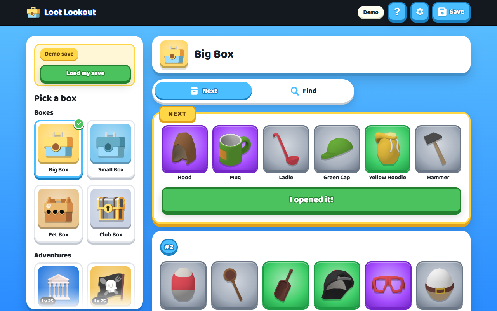

# Loot Lookout

> See what's in your next Eatventure box.

Loot Lookout is a loot predictor for Eatventure. Load your save and it shows, in order, the exact items each of your boxes, eggs and adventure chests will drop, with the real game art, names and rarity colours.

Everything runs in the browser. Your save is read on your own device, never uploaded, and never changed. Try it at [justinasla.github.io/loot-predictor](https://justinasla.github.io/loot-predictor/), or tap **Try demo** to explore without a save.

## Features

- **Next drops** — every upcoming opening, in order, with the real item art on rarity-coloured tiles.
- **One-tap tracking** — tap **I opened it!** after opening a box in the game to stay in step, with **Undo** for mistakes.
- **Find an item** — tap the pictures of the items you want and see how many openings away they are.
- **XP planner** — for Zeus and Pirate adventures, picks the level for each opening that earns the most XP, vault keys included.
- **Every box** — Big, Small, Pet and Club boxes, eggs, event boxes and adventure chests.
- **Private by design** — the tracker is stored only in your browser, and **Remove from this device** clears it.
- **Built for phones** — the layout follows the phone you play on, and works just as well on desktop.

## License

Copyright (c) 2026 Justinas Launikonis. No license has been granted for this project's code yet.

Eatventure and its game artwork belong to Lessmore GmbH and their respective rights holders. The artwork is not covered by this project's copyright; see [asset sources and attribution](docs/ASSETS.md).

## Credits

Created by [Justinas Launikonis](https://github.com/JustinasLa).

Game artwork from [Eatventure](https://apps.apple.com/us/app/eatventure/id1600871388) by Lessmore GmbH, via the [1vcian/ev](https://github.com/1vcian/ev) reference implementation. Item names were checked against [Eatventure Tools](https://eatventuretools.app/) and the [Eatventure Wiki](https://eatventure.fandom.com/wiki/Clothing).

Loot Lookout is an unofficial fan tool, not affiliated with Eatventure or Lessmore.

## Documentation

[Technical documentation](docs/TECHNICAL.md): how predictions work, running locally, tests, the CLI and library use.

The [design spec](docs/DESIGN.md) covers the UI, and [asset sources](docs/ASSETS.md) record where every image comes from.
